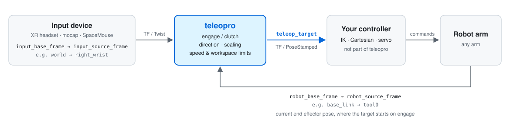

<div align="center">

# Teleopro

**Teleop Like a Pro: any input device, any robot arm.**

[](https://pypi.org/project/teleopro-core/)
[](https://docs.ros.org/en/jazzy/)
[](https://pypi.org/project/teleopro-core/)
[](LICENSE)
[](https://arxiv.org/abs/2610.25006)

English | [简体中文](README.zh-CN.md)

</div>

Give it two frames on the device and two frames on the robot arm; it outputs a
target pose that moves the way your device moves:

<p align="center">
  
</p>

teleopro does not command the robot arm. Feed the target to whatever moves your
robot (IK, a Cartesian controller, servoing, ...).

- Works with pose devices (XR headsets, mocap) and velocity devices
  (SpaceMouse, joystick, keyboard)
- Clutch: engage to follow, disengage to hold; the target never jumps
- Direction mapping, motion scaling, speed limits, workspace box, axis locking
- Tested on a Universal Robots UR5e with ROS 2 Jazzy

## Packages

| Package | For | Install |
|---|---|---|
| [`teleopro_ros`](teleopro_ros/README.md) | ROS 2: set frames in a yaml, get a TF | Build from source, see its [README](teleopro_ros/README.md#build) |
| [`teleopro_core`](teleopro_core/README.md) | Any Python program, no ROS | `pip install teleopro-core` |

`teleopro_ros` is a thin ROS 2 wrapper around `teleopro_core`, so both behave the same.

## Limitations and safety

- **Cartesian control only.** teleopro outputs a Cartesian target pose for the end
  effector, so you need a Cartesian controller or IK to execute it. Joint-space
  control is not supported.
- **When testing on a real robot:**
  - Keep a hand on the teach pendant's stop button at the beginning.
  - Slow the robot down: lower the robot speed and start with small
    `max_lin_vel` / `max_ang_vel` (e.g. `0.05` m/s, `0.2` rad/s).

## Citation

If you use teleopro in your research, please cite:

```bibtex
@article{duan2026scalable,
  title={Scalable, Intuitive, Mixed Reality-Based Semi-Autonomous Robotic Telemanipulation for the Execution of a Fine-Grained Bimanual Task},
  author={Duan, Shifei and Wang, Zhe and De Pace, Francesco and Liarokapis, Minas},
  journal={arXiv preprint arXiv:2610.25006},
  year={2026}
}
```

## License

Apache-2.0
